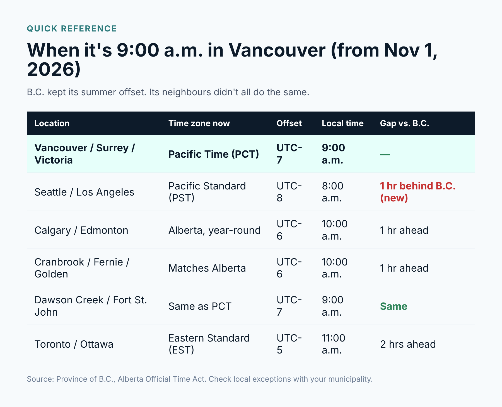
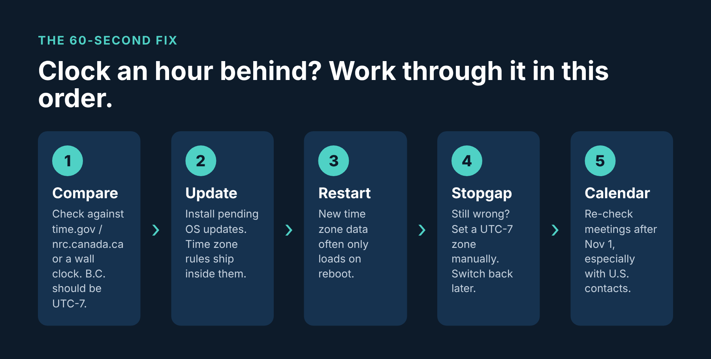
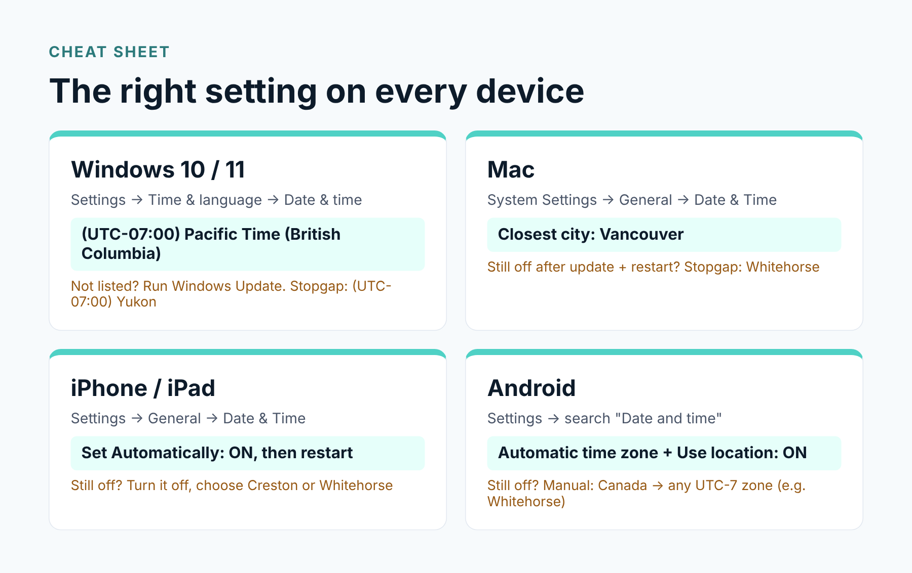

If you woke upthis morning and your phone said one thing, your laptop said another, and themicrowave was somehow the only one telling the truth, you’re not alone. Ourphones at Ayvant started lighting up before 8 a.m.

Here’s whathappened. B.C. did not fall back last night. The province moved its clocksforward on March 8 for the last time, and as of today it’s officially on PacificTime (PCT), UTC-7, all year round. The old PST label is gone. But plenty ofphones, PCs and calendar apps still have the old rule baked in, so overnightthey quietly rolled themselves back an hour.

The good news:it’s usually a two-minute fix. Below is what’s going on, how to check your owndevices, and the exact settings for Windows, Mac, iPhone and Android.

## What actually changed in B.C. on November 1?

The shortversion: the clocks you set in March are the clocks you keep. The provinciallaw behind this was passed back in 2019, but it sat on the shelf waiting forWashington, Oregon and California to move too. That didn’t happen, so B.C. wentahead on its own this year.

•     New name: Pacific Time (PCT). PST and PDT areretired in B.C.

•     Offset: UTC-7, the same as summer time. No moreswitching.

•     Alberta did something similar and is now onUTC-6 all year. East Kootenay communities like Cranbrook, Fernie, Golden andInvermere stay matched with Alberta.

•     Northeast B.C. (Dawson Creek, Fort St. John,Fort Nelson and others) already shows the same time as PCT, so nothing changesthere.

The part that trips people up is our neighbours to the south.Washington, Oregon and California did fall back. So for the first time, Vancouveris now an hour ahead of Seattle through the winter. If you work with U.S.clients or have a team in L.A., that matters.

## Why are phones and computers getting it wrong?

Your devicesdon’t “know” what time it is in B.C. They know what time it is in UTC, and theylook up a rulebook (the time zone database) to work out local time. Apple,Microsoft and Google all pushed updated rulebooks over the last few months. Ifa device hasn’t installed that update, or installed it but hasn’t restartedsince, it’s still reading the old page that says “Vancouver falls back on thefirst Sunday in November.”

That’s whyyou’ll see one phone right and the one sitting next to it wrong. Same carrier,same Wi-Fi, different update history.

A quick way to check: compare your device against the National ResearchCouncil’s official time (nrc.canada.ca) or simply a laptop you know is up todate. In B.C. right now, the correct offset is UTC-7.

## How to fix the time on Windows 10 and Windows 11

1.    Open Settings > Windows Update and installeverything waiting. Microsoft shipped the B.C. change in its fall 2026 updates(October’s Patch Tuesday for most machines).

2.    Restart. Not “shut the lid”. A real restart.

3.    Go to Settings > Time & language > Date& time and make sure the time zone reads (UTC-07:00) Pacific Time(British Columbia). Heads up: in the dropdown it may sit above the otherUTC-7 entries rather than in number order.

4.    Leave Set time automatically on, then click Syncnow.

Can’t findthe British Columbia option? Your PC hasn’t got the update yet. As astopgap, choose (UTC-07:00) Yukon. Yukon has been on UTC-7 year-roundsince 2020, so the clock will be right. Switch it back once the update lands.This is also the answer for Windows 10 machines that aren’t on ExtendedSecurity Updates, though honestly, that’s a sign it’s time to talk aboutreplacing them.

One warning:don’t pick “(UTC-08:00) Pacific Time (US & Canada)”. That’s the oldrule, and it’s exactly what’s causing the problem.

## How to fix the time on a Mac

1.    Open System Settings > General > SoftwareUpdate and install any macOS update.

2.    Restart. Macs often go weeks without a reboot, and thenew time zone data only loads on startup.

3.    Go to System Settings > General > Date &Time. Keep Set time and date automatically on, and set the closestcity to Vancouver.

Stillshowing an hour behind? Turn off automatic time zone and pick Whitehorseas the closest city. Same time, different label. Set it back to Vancouver afteryour next macOS update.

## How to fix the time on an iPhone or iPad

1.    Go to Settings > General > Software Updateand install whatever’s there.

2.    Go to Settings > General > Date & Timeand make sure Set Automatically is on.

3.    If you see a note about updated time zone definitions, restartthe phone. That’s the step most people skip.

Some iPhoneshave started showing Creston or “Mountain Standard Time” as the city.Looks wrong, but it isn’t: Creston is a B.C. town that’s been on UTC-7 all yearfor decades, so the clock matches. If yours is still an hour off after arestart, turn off Set Automatically and choose Creston or Whitehorse yourself.Just remember to flip it back on later, otherwise your phone won’t adjust whenyou travel.

## How to fix the time on Android (Samsung, Pixel and others)

Google flaggedthis one publicly ahead of the change. Older Android software may move theclock back an hour on November 1 even though it shouldn’t.

1.    Install all pending updates. On Android that means twoplaces: the regular System update from your phone maker, and the GooglePlay system update (Settings > Security & privacy > System &updates on most phones; the menu names vary a bit on Samsung).

2.    Restart the phone.

3.    Open Settings and search “Date and time”. Turnon Automatic time zone and Use location to set time zone.

4.    Still wrong? Turn automatic time zone off, choose Canadaas the region, and pick a UTC-7 zone such as Whitehorse.

## Don’t forget your calendar

This is wherethe real headaches show up, usually a few days later. A clock that’s an houroff is obvious. A meeting that quietly moved by an hour is not.

•     Recurring meetings created before today mightshift, especially ones with people in the U.S. or Alberta. Open your next twoweeks and eyeball them.

•     Outlook on the web and new Outlook: Settings> Calendar > View > Time zones, then set it to (UTC-07:00) PacificTime (British Columbia).

•     Only the organizer should fix a shared meeting.If everyone edits their own copy, things get messy fast.

•     Google Calendar is moving most affected eventsback automatically. Check the web version for a “Move one hour earlier” prompton anything it couldn’t fix. Invites that came from Outlook aren’t included.

•     Booking tools like Calendly, Jane, Clio or yourdental scheduling software each have their own time zone setting. Check them,and double check any appointment reminders going to clients this week.

## For business owners: a quick checklist

If you run anoffice, a wrong clock is more than an annoyance. It’s missed appointments,payroll punches in the wrong hour, and log timestamps that don’t line up whenyou need them for an audit or a security investigation. Here’s what we’rechecking for our own clients this week:

* Every workstation and laptop is patched and has beenrestarted since October.
* Servers, firewalls and network gear are pulling timefrom a reliable source and show UTC-7.
* Time clocks, door access systems, phones (VoIP) andsecurity cameras are showing the right time. These are the ones people forget.
* Line-of-business apps (practice management, accounting,CRM) have the correct time zone in their own settings.
* Client-facing reminders and booking pages show theright time, especially if you serve U.S. clients.

## The bottom line

B.C. is onUTC-7 now, and it’s staying there. If something’s an hour behind, it’s almostalways a missing update or a device that hasn’t restarted. Update, restart,check the setting, and you’re done.

If you’ve got awhole office to sort out, or you’d rather not spend Monday morning walking deskto desk, give us a shout. Ayvant’s team in Langley and Surrey can push the fixto every device remotely and make sure nothing slipped through. Book a quickcall at ayvant.ca.

### Frequently asked questions

**Did B.C.fall back on November 1, 2026?**

No. B.C. movedits clocks forward on March 8, 2026 for the last time and stayed there. Theprovince is now on Pacific Time (UTC-7) all year.

**Why is myphone an hour behind in B.C.?**

Your device isstill using old time zone rules that tell it Vancouver falls back to PST inNovember. Installing the latest update and restarting usually fixes it.

**What timezone should I choose on Windows in B.C.?**

Pick(UTC-07:00) Pacific Time (British Columbia). If it isn’t in the list yet, runWindows Update. As a short-term fix, (UTC-07:00) Yukon shows the same time.

**Is B.C. nowon the same time as Seattle?**

No. FromNovember 1, 2026, Vancouver is one hour ahead of Seattle, Portland and LosAngeles until the U.S. springs forward in March.

**Does all ofB.C. use the new Pacific Time?**

Most of it.Northeastern communities like Dawson Creek and Fort St. John already show thesame time. Southeastern areas like Cranbrook, Fernie and Golden follow Alberta(UTC-6).

*Sources: Province of British Columbia (gov.bc.ca); UBC IT;Google Android guidance on Canadian time changes; Microsoft Windows releasenotes. Information current as of November 1, 2026.*
